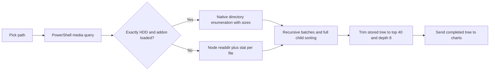

Historical review: this records the implementation at the time of the review, under the former DiskVision name. For current behavior and performance limits, see [the 1.1.0 roadmap](../plans/2026-11-03-adopted-priorities.md).

**DiskVision: scan performance, accuracy, and usability review — 31 October 2026**

The recommended path is to repair accounting and cancellation, make native bulk metadata enumeration the normal scanner, and keep results browsable while scanning. Add direct NTFS Master File Table (MFT) scanning for large whole-volume scans, then a persistent index updated from the Windows USN change journal. Keep engine selection automatic.

This review combines source inspection, small local execution checks, Microsoft API documentation, current product documentation, and research papers. The recommendations below are a proposed design; application code has not been changed.

**The current scan is recursive tree traversal with batched asynchronous work.**

The JavaScript implementation lists each directory, processes entries in batches of 64, reads each file's metadata separately with `stat`, and recursively waits for directories in that batch. The native implementation also traverses directories, but obtains file sizes during enumeration. Both eventually sort children by size, retain 40 plus an aggregate, and stop materializing descendants at depth 8 while continuing to count their bytes.

This identification is high confidence from control flow. The diagram describes the code, not a measured execution timeline. Increasing batch size does not change the need to enumerate metadata, and a limit of 64 per recursive call is not a global concurrency or memory limit. The depth and child limits reduce retained detail; they do not avoid scanning the corresponding files.

**Several accuracy defects should be fixed before expanding the fast path.**

| Priority | Finding | Evidence | Change |
|---|---|---|---|
| P1 | Native cancellation sets `aborted` to false. Both scanners can absorb cancellation through `Promise.allSettled` and publish completion. | [Native cancel](../../src/main/scanner-native.ts:93), [JS batch handling](../../src/main/scanner-fast.ts:215) | Give each scan its own state and ID; check cancellation after awaits and before completion. Emit one explicit terminal state. Ignore stale events from earlier scans. |
| P1 | Native read failures become successful empty arrays, including missing paths. End-of-enumeration errors are not distinguished from normal exhaustion. | [Native enumeration](../../native/fast-readdir.cpp:59) | Preserve Win32 error codes. Separate empty, inaccessible, failed, cancelled, and partial results. Count every error, even if only a bounded sample of paths is retained. |
| P1 | Legitimate folders beginning with `$` are silently skipped. Every native reparse point is treated as a symlink. | [Folder filtering](../../src/main/scanner-fast.ts:280), [reparse classification](../../native/fast-readdir.cpp:69) | Use explicit exclusions and reparse-tag classification. Count ordinary file placeholders appropriately; avoid following junctions by default and report excluded subtrees. |
| P1 | Charts discard the size of aggregate directories with `children: []`. | [Treemap](../../src/renderer/src/components/visualization/TreemapChart.tsx:46), [sunburst](../../src/renderer/src/components/visualization/SunburstChart.tsx:50) | Give aggregate and unloaded nodes explicit kinds. Chart weighting must retain their authoritative total. |
| P1 | Deleting any node recalculates all directories from materialized children, zeroing unrelated aggregate totals. | [Store update](../../src/renderer/src/store/scan-store.ts:86) | Update authoritative records and affected ancestors, then refresh the affected subtree. Do not rebuild totals from a truncated display tree. |
| P1 | Personal documents and media are labeled “Safe to delete.” | [Classification](../../src/renderer/src/lib/safety.ts:86) | Use “Personal file — review” or “Possible cache/generated files,” with the reason. Preserve Recycle Bin confirmation. |
| P2 | Synthetic “Other” nodes have a fabricated filesystem path and can receive file actions. | [Aggregate construction](../../src/main/scanner-fast.ts:243) | Give aggregate nodes an internal ID and “Show remaining items”; no Explorer/delete action. |
| P2 | Scan errors are stored but not shown by the app. | [Error handling](../../src/renderer/src/hooks/useScanner.ts:25), [main view](../../src/renderer/src/App.tsx:49) | Add visible failure/retry states and a clickable list of skipped/inaccessible paths. |
| P2 | The scanner hook mounts in both the sidebar and progress panel, duplicating drive queries and event subscriptions. | [Sidebar](../../src/renderer/src/components/layout/Sidebar.tsx:6), [progress panel](../../src/renderer/src/components/panels/ScanProgress.tsx:8) | Initialize one scan controller at app level; components consume selectors/actions. |
| P2 | All subtrees are built before trimming, and native results create a complete JS object array on the Electron main thread. | [Retained results](../../src/main/scanner-fast.ts:212), [native conversion](../../native/fast-readdir.cpp:92) | Use bounded chunks and a worker/helper process. Keep an index separate from the rendered tree. |

**Local execution checks support these findings, with limited performance scope.**

- Cancelling on the first progress event made the JS scanner emit completion with zero files and no errors; the native scanner still completed all 38 source files, totaling 90,340 bytes.
- Enumerating a nonexistent path through the existing native addon returned `[]`. Scanning it emitted completion with zero bytes and no errors.
- A synthetic chart input containing a 10-byte file and a 100-byte aggregate had a chart value of 10 instead of 110. Removing the file through the store left a reported total of zero instead of 100. These were in-memory checks; no user files were deleted.
- `npm run build` passed. The initial sandbox attempt could not spawn esbuild; the approved retry succeeded.
- Main-process type checking failed because both scanners import types from missing `./scanner`. Renderer type checking failed because imported preload types are outside the composite project's include list. The build currently succeeds without enforcing these checks.

For a small timing comparison, both scanners read the local dependency directory four times each, alternating which ran first. All eight results agreed on 13,949 files, 1,666 directories, and 557,140,915 logical bytes, with zero reported errors.

| Round | First engine | JavaScript scan | Native scan |
|---|---|---:|---:|
| 1 | JavaScript | 241.83 ms | 136.25 ms |
| 2 | Native | 203.62 ms | 116.20 ms |
| 3 | JavaScript | 210.62 ms | 117.01 ms |
| 4 | Native | 194.17 ms | 114.15 ms |
| Median | — | 207.12 ms | 116.61 ms |

The native median was approximately 1.78 times faster. This is a small, warm-cache-oriented, same-process smoke comparison under Node v24.14.0 using the existing native binary. It did not include drive discovery, Electron IPC, chart rendering, cold-cache control, native rebuilding, installer verification, or whole-volume workloads. Counts agreeing also does not prove completeness: both engines share some exclusions. Treat this as evidence to prioritize a proper native-on-SSD experiment, not a product speed guarantee.

**Choose the scanner using the actual volume and scan scope.**

| Situation | Proposed automatic strategy | Reason and limitation |
|---|---|---|
| Selected folder without a validated saved index | Native bulk directory metadata enumeration | Avoids the separate per-file `stat` pass; requires no whole-volume scan. |
| Whole local NTFS volume with permission for acceleration | Direct MFT reader in an isolated, read-only helper | Reduces repeated directory/path work. Requires a robust NTFS parser and fallback. |
| Previously indexed volume with a valid USN history | Show cached results, visibly marked as updating, then reconcile changes | Avoids rescanning unchanged metadata. Requires consistency and recovery logic. |
| ReFS, FAT/exFAT, network share, unavailable elevation, or unsupported acceleration | Native directory walker with capability checks; JS compatibility fallback if necessary | Filesystem and provider support vary. Report the actual completeness. |

The fastest near-term change is to use the repaired native engine on SSDs and unknown media as well as HDDs. `FindFirstFileExW` exposes metadata while enumerating. Its large-fetch flag uses larger query buffers; it does not guarantee that 1,000 entries require exactly one physical I/O. The README's “1001 I/O ops → 1” claim should be replaced with “eliminates separate per-file stat calls.” [Microsoft enumeration API](https://learn.microsoft.com/en-us/windows/win32/api/fileapi/nf-fileapi-findfirstfileexw)

Prototype richer directory enumeration through `GetFileInformationByHandleEx`. Supported directory information classes can return logical length, allocation size, file ID, and reparse tag in batches. Capability-test the classes, buffer handling, and providers; keep a fallback. Add targeted extra metadata reads for cases where the fast record is insufficient, instead of blindly restoring one extra query per file. [Information classes](https://learn.microsoft.com/en-us/windows/win32/api/winbase/nf-winbase-getfileinformationbyhandleex), [extended directory record](https://learn.microsoft.com/en-us/windows/win32/api/winbase/ns-winbase-file_id_extd_dir_info)

Direct MFT scanning is established practice: WizTree documents it, and current WinDirStat uses it for elevated full local NTFS scans with normal traversal for unsupported targets. This is the most promising larger improvement for a first full-drive scan. A new implementation must handle record fixups, attribute lists, resident/nonresident data, multiple names/links, sparse/compressed streams, file-ID reuse, malformed records, and concurrent changes. Reuse established techniques after checking licensing; do not treat a minimally working parser as production ready. [WizTree](https://diskanalyzer.com/), [WinDirStat scanning](https://github.com/windirstat/windirstat/wiki/Scanning)

`FSCTL_ENUM_USN_DATA` is a different option: its records contain IDs, parents, names, and change information, but no file-size field. Enumerating those records alone is not an instant disk-size scan. It still needs a size acquisition strategy. [Enumeration API](https://learn.microsoft.com/en-us/windows/win32/api/winioctl/ni-winioctl-fsctl_enum_usn_data), [USN record definition](https://learn.microsoft.com/en-us/windows/win32/api/winioctl/ns-winioctl-usn_record_v2)

**Volume discovery should populate the picker before a recursive scan.**

The current model has only letter, label, capacity, and free space. It launches PowerShell before choosing an engine. Reducing a selected path to a drive letter misidentifies folder-mounted volumes and can treat a UNC server name as a local drive. [Current discovery](../../src/main/drive-info.ts:14), [routing](../../src/main/ipc-handlers.ts:26)

Use a volume record containing stable volume identity, mount paths, filesystem, capacity/free space, availability, and physical-device information when available. Enumerate local volumes with `FindFirstVolumeW`/`FindNextVolumeW`, resolve selected paths with `GetVolumePathNameW`, and obtain capacity/free-space information without walking files. Discover mapped network paths separately. Account for per-user quotas when displaying capacity/free values. [Volume discovery](https://learn.microsoft.com/en-us/windows/win32/api/fileapi/nf-fileapi-findfirstvolumew), [path resolution](https://learn.microsoft.com/en-us/windows/win32/api/fileapi/nf-fileapi-getvolumepathnamew), [space query](https://learn.microsoft.com/en-us/windows/win32/api/fileapi/nf-fileapi-getdiskfreespaceexw)

Map local volumes to physical disks where supported. Two partitions on one HDD share the same seek budget; treating each partition as an independent high-concurrency device can worsen latency. Use volume disk extents and optional seek-penalty information as scheduling hints, with a conservative fallback for virtual, RAID, or unknown devices. This scheduling recommendation is an inference from device sharing, and needs benchmarking. [Disk extents](https://learn.microsoft.com/en-us/windows/win32/api/winioctl/ni-winioctl-ioctl_volume_get_volume_disk_extents), [seek-penalty descriptor](https://learn.microsoft.com/en-us/windows/win32/api/winioctl/ns-winioctl-device_seek_penalty_descriptor)

Partition capacity is not a reliable estimate of scan cost. A large volume with few files can be cheaper to scan than a smaller volume with millions of files. NTFS metadata-table size can also reflect past usage. Base backend selection on filesystem, scope, and capabilities; use prior timings or observed metadata work to tune scheduling. [Microsoft MFT documentation](https://learn.microsoft.com/en-us/windows/win32/fileio/master-file-table)

Picking only a folder or selected volumes reduces the work genuinely requested. Showing only files above a size threshold usually reduces display/index work, not initial enumeration: their sizes still have to be discovered. Cached large subtrees can be prioritized to improve time to useful results, but provisional totals must remain labeled incomplete.

**Bound work globally and keep the authoritative data separate from the charts.**

Use one directory queue and a fixed pool of workers. Each work item enumerates a directory, emits bounded metadata chunks, and queues discovered directories; it must not hold a scarce worker permit while waiting for its descendants. Apply backpressure to queued bytes and records as well as outstanding operations. Tune concurrency using measured throughput and responsiveness; HDD/SSD labels are hints, not a reason for unlimited work.

Store compact records keyed by volume and file identity, with parent relationships and names. Materialize full paths when needed. Keep authoritative totals in this index and send only the visible subtree, top files, and summary updates to the renderer. A top-k heap can avoid fully sorting every sibling set merely to display the largest 40; it does not remove the need to read metadata for accurate totals. Page or virtualize the remaining records instead of deleting them from the data model.

Run native scanning/indexing outside Electron's main process. Publish throttled progress and partial folder summaries independently of recursion entry points, so giant file-only directories and deep aggregation cannot make the interface appear stalled. A helper process also contains native crashes and gives cancellation a clear lifecycle. Keep native fast-path elevation isolated to the read-only helper when needed.

**A saved index can make repeat scans much cheaper, if freshness is explicit.**

Persist the volume identity, index format/policy version, journal identity, and last applied USN. Capture a journal position before initial scanning, then reconcile changes recorded during the scan. Treat change events as reasons to query current metadata, deduplicate repeated notifications, and update ancestor totals transactionally. Renames/moves affect both the old and new parent chains; hard-link changes need explicit link handling.

If the journal is recreated, required records have been discarded, the volume changes identity, or indexing policies change, invalidate the affected cache and rebuild. If no valid journal is available, show saved data as stale and perform a normal rescan. A live scan is not an atomic snapshot: show the last completed reconciliation time, explain that results may still reflect concurrent changes, and refresh items before acting on them. Snapshot support can be a later advanced feature if strict point-in-time semantics are required. [Journal identity](https://learn.microsoft.com/en-us/windows/win32/fileio/using-the-change-journal-identifier), [journal boundaries](https://learn.microsoft.com/en-us/windows/win32/api/winioctl/ns-winioctl-usn_journal_data_v0), [change reading](https://learn.microsoft.com/en-us/windows/win32/api/winioctl/ni-winioctl-fsctl_read_usn_journal)

**Define what “size” means before optimizing its acquisition.**

| Quantity | Meaning in the proposed app |
|---|---|
| File size | Logical length of the included streams; explicitly state stream policy. |
| Space on disk | Measured allocated storage, with filesystem/provider limitations recorded. |
| Potentially reclaimable | An estimate considering shared links and the planned action; never automatically equal to logical size. |
| Windows used space | A separate volume statistic, not the sum of currently visible tree rows. |

The current scanners report logical length of the normal data stream. Hardlinks, sparse/compressed files, alternate streams, cloud files, metadata, and inaccessible folders prevent that sum from explaining all occupied space. Use per-volume file IDs to identify hardlinks, and define a deterministic attribution policy for shared allocation so directory totals do not silently double-count it. Clarify that removing one hardlink may free no file data, and moving an item to the Recycle Bin does not itself guarantee more free space. [TreeSize NTFS accounting notes](https://manuals.jam-software.com/treesize/EN/notesonntfs.html)

Do not estimate compressed/sparse allocation by rounding logical length to cluster size. Use appropriate metadata, with targeted compression/sparse queries when required. Avoid reading file contents during scanning. Reparse tags must distinguish links from cloud/provider objects; some virtualized directories can trigger retrieval during enumeration, so skipped/unavailable cloud content needs an explicit incomplete status. [Compressed/sparse size](https://learn.microsoft.com/en-us/windows/win32/api/fileapi/nf-fileapi-getcompressedfilesizew), [file attributes](https://learn.microsoft.com/en-us/windows/win32/fileio/file-attribute-constants)

Display an explained system/unattributed difference where possible. Do not force file sums to equal used capacity or manufacture a reassuring percentage. If measurements do not reconcile, show the discrepancy. [WizTree's discussion of discrepancies](https://diskanalyzer.com/faq)

**The simplest interface is a drive picker followed by a useful size-sorted list.**

1. Show accessible volumes with name, mount path, used/free capacity, filesystem, and a Scan button. Offer Choose folder alongside them. Show loading, failure, offline/locked, and empty states distinctly. Keep engine selection automatic and optional acceleration understandable.
2. Show a size-sorted folder/file table as data arrives, with names, measured size, share of analyzed space, and status. Keep a treemap as an optional companion. A table is easier to search, navigate with a keyboard, and use for long filenames.
3. Keep results navigable during scanning. Show a small progress strip with observed counts, stage, elapsed time, Stop, and an explicit partial/updating label. Avoid a percentage unless a meaningful denominator is known.
4. Make Other expandable, preserve breadcrumbs and selection, and support Enter/Back navigation. Offer largest files and refresh selected folder from the same result set.
5. Surface inaccessible/skipped counts and logical-versus-allocated explanations only where relevant. Retain the previous result while refreshing, visibly marked as old, and reject events from older scan IDs.
6. Use Review and Open in Explorer as ordinary actions. Explain why an item might be a cleanup candidate; an extension or directory name is not evidence that the contents are disposable.

**The research supports metadata reuse and locality; its performance ratios do not transfer automatically.**

| Primary source | Applicable idea | Limit of the evidence |
|---|---|---|
| [FastDu, 2011](https://www.sciopen.com/article/10.1016/S1007-0214%2811%2970049-9) | Store directory summaries and revisit only directories affected by changes. This directly motivates incremental refresh. | The publisher abstract describes syscall interception and cached summaries. A Windows adaptation should use supported change mechanisms; the reported speedups are not measurements of this app. |
| [Spyglass, FAST 2009](https://www.usenix.org/events/fast09/tech/full_papers/leung/leung.pdf) | Metadata indexes organized around namespace locality, selective queries, and incremental collection. | Its snapshot-assisted storage integration differs from a desktop Windows application. Metadata-index partitions are not physical disk partitions. |
| [FlatFS, USENIX ATC 2022](https://www.usenix.org/conference/atc22/presentation/cai) | Reducing expensive path/tree traversal and improving metadata locality can matter substantially. | This is a filesystem design for nonvolatile memory, not a drop-in NTFS scanner. Its measurements support a design direction, not a DiskVision speed estimate. |

The README's XN-Graph citation concerns nearest-neighbor search, as listed by the [authors' laboratory](https://cmmlab.xmu.edu.cn/pub_cn.html). It may motivate overlapping work, but it does not validate batch size 64, a claimed threefold reduction in waiting, or filesystem scan throughput. The existing benchmark is the relevant local evidence and needs stronger controls.

**Implement in four reviewable stages, with correctness gates.**

| Stage | Work | Gate before progressing |
|---|---|---|
| 1: Trustworthy results | Cancellation/session IDs; Win32 errors; exclusions/reparse policy; chart/store aggregates; visible errors; typecheck configuration; truthful cleanup labels | Cancel never publishes success; partial scans are labeled; fixture byte totals and chart totals agree; typechecks and build pass. |
| 2: Fast ordinary scans and simple UI | Native default; global bounded queue; worker isolation/chunking; cached volume discovery; progressive size table; paginated full metadata | Compare on SSD/HDD/network paths; verify matching semantics and peak memory; measure first useful result and stop latency. |
| 3: NTFS acceleration | Optional read-only MFT helper; automatic fallback; allocation and hardlink accounting | Full-volume parity under defined policies; malformed-record and permission handling; packaged helper/addon validation. |
| 4: Cheap refresh | Persistent index; USN reconciliation; stale-state recovery; subtree refresh | Creates, deletes, renames, moves, link changes, journal gaps, device replacement, and interrupted updates recover correctly. |

A possible prioritization adjustment is to ship the persistent index before direct MFT parsing if repeat scans dominate real usage. The worker/index separation makes that choice possible without redesigning the UI.

**Replace the benchmark's current speed claims with reproducible measurements.**

The current harness always runs the original scanner first, omits surrogate-character filenames only in that baseline, suppresses all unhandled rejections, and prints differing counts without failing. It does not compare native scanning. End-of-run heap delta is not peak memory and does not include native allocation. [Benchmark baseline](../../benchmark/run.ts:65), [measurement](../../benchmark/run.ts:217), [execution order](../../benchmark/run.ts:278)

Use identical policies and assert known counts/bytes before reporting timing. Cover small and very wide/deep trees, millions of small files, large sparse/compressed files, hardlinks, junction loops, cloud placeholders, emoji and long paths, access-denied paths, concurrent modifications, disconnects, and stop/restart races. Compare folder and full-volume scans on NTFS SSD/HDD, removable exFAT, ReFS where available, and SMB. Include two volumes sharing one physical disk.

Measure discovery delay, time to first useful result, total scan time, peak process-tree RSS including native/helper allocations, CPU, I/O activity, renderer/main-thread responsiveness, and cancellation acknowledgment plus actual worker-stop latency. Separate cold and warm conditions; vary engine order and repeat enough runs for medians and meaningful tail measurements. Measure index storage and refresh latency separately. Fail on unhandled rejections and unexpected count/size differences. Validate the actual packaged Electron runtime as well as standalone scanner benchmarks.
